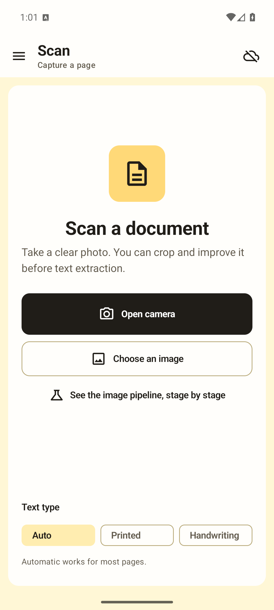
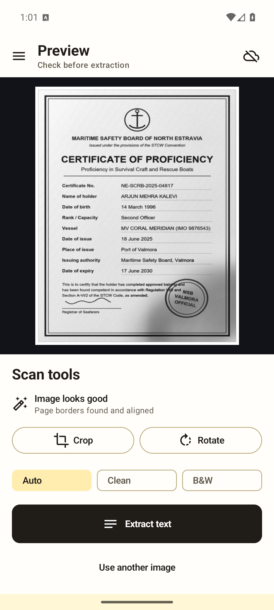
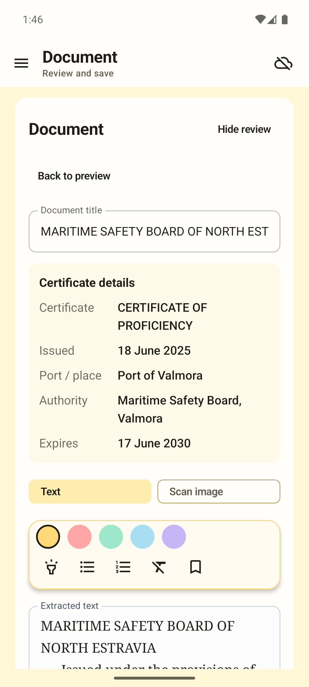
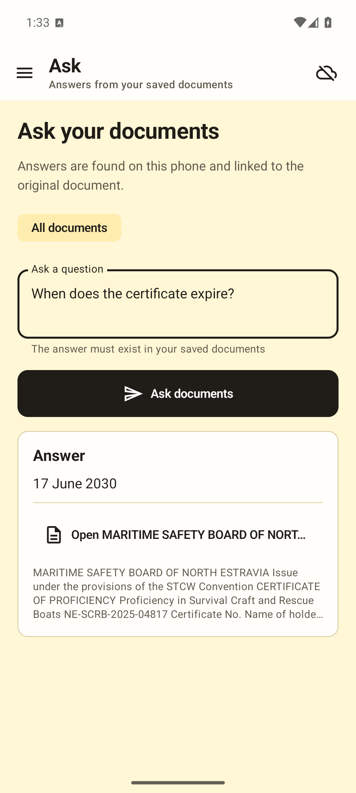

# NavCert Offline

NavCert Offline is an Android app that reads maritime and seafarer certificates without the internet. Point the phone camera at a certificate. The app finds the page, flattens and cleans it, reads the printed and handwritten text, pulls out five certificate fields, and saves the document on the phone. You can then ask questions about your saved documents, still offline.

The app has no internet permission. Every image, model and document stays on the device.

<table>
  <tr>
    <td></td>
    <td></td>
    <td></td>
    <td></td>
  </tr>
  <tr>
    <td align="center">Capture</td>
    <td align="center">Detect and flatten</td>
    <td align="center">Five fields</td>
    <td align="center">Ask offline</td>
  </tr>
</table>

All screenshots use a synthetic certificate generated by `tools/make_sample_certificate.py`. More are in [`docs/screenshots/`](docs/screenshots/).

## Features

- **Capture.** Camera through the system camera app (no camera permission) or an image from the system picker. Auto, Printed and Handwriting text modes.
- **Crop and rotate.** A crop editor for difficult photos.
- **Page detection and rectification.** OpenCV finds the largest four-cornered page and warps it flat. Quality hints flag dark, bright or soft photos.
- **Enhancement.** Auto, Clean and B&W modes (CLAHE, median filter, unsharp mask, adaptive threshold).
- **On-device OCR.** ML Kit Text Recognition for print. A bundled PP-OCRv5 model on ONNX Runtime for handwriting, with ML Kit as fallback. Layout is rebuilt from box geometry.
- **Certificate fields.** Certificate name, issue date, port of issue, issuing authority and expiry date. Rules first, then a fine-tuned int8 MiniLM (ONNX), then MobileBERT (TensorFlow Lite). Non-certificates are skipped, so no dates are invented.
- **Review and edit.** Editable text, highlights, notes and bookmarks. Conservative OCR post-correction with a maritime vocabulary.
- **Library.** Search, folders, move and delete. Documents are JSON plus a JPEG preview in app-private storage.
- **Ask.** Questions over saved documents: local chunk retrieval plus MobileBERT extractive QA, with the source document shown.
- **Pipeline Lab.** Every image-processing stage shown on the current scan or a bundled synthetic certificate.
- **Privacy & offline screen.** What the app does and does not do with your data.

## Architecture

```
Capture ─► Crop ─► Process (OpenCV) ─► OCR ─► Extract ─► Review ─► Store ─► Ask
camera     crop     detect, warp,       ML Kit   rules       edit     JSON +    retrieval +
picker     editor   enhance, quality    PP-OCRv5 MiniLM      notes    JPEG      MobileBERT
                                        (ONNX)   MobileBERT
```

| Layer | Files |
| --- | --- |
| Activities | `MainActivity.kt` (Compose host, navigation drawer, scan state machine), `CropEditorActivity.kt` |
| Screens | `ScanWorkflowScreens.kt`, `AppScreens.kt` (documents, ask, privacy, about), `PipelineLabScreen.kt` |
| Vision | `DocumentScanner.kt` (OpenCV), `IvpOperations.kt` and `PipelineLabProcessor.kt` (Pipeline Lab) |
| OCR | ML Kit, `PaddleHandwritingRecognizer.kt` (PP-OCRv5, ONNX Runtime), `DocumentTextFormatter.kt`, `OcrTextCorrector.kt` |
| Understanding | `CertificateFieldExtractor.kt`, `CertificateOnnxAnswerer.kt` (MiniLM int8 + WordPiece tokenizer), `OfflineDocumentAssistant.kt` (retrieval + MobileBERT) |
| Storage | `DocumentRepository.kt` (`files/documents/<uuid>.json` + `.jpg`, atomic writes) |

Kotlin, Jetpack Compose with Material 3, coroutines (`Dispatchers.IO` for files, `Dispatchers.Default` for vision and ML). `minSdk 24`, `targetSdk 36`. The navigation drawer is modal on phones and permanent at 840 dp and wider. Full architecture notes: [`docs/rubrics/mad.md`](docs/rubrics/mad.md).

## IVP Pipeline Lab

The Pipeline Lab (side menu) walks through twelve stages on a real scan or the bundled synthetic certificate: fundamentals, point processing, histogram and CLAHE, filtering and the Fourier spectrum, DCT compression, edges, morphology, segmentation, colour, page geometry and steady capture (block matching). Each stage shows the image and its key numbers. The operations are pure Kotlin in `IvpOperations.kt`, covered by unit tests. Syllabus mapping: [`docs/rubrics/ivp.md`](docs/rubrics/ivp.md).

## ML pipeline

- [`ml/README.md`](ml/README.md): corpus preparation, PP-OCR bootstrap labels, certificate QA fine-tuning, int8 ONNX export and gold-set evaluation.
- [`ml/ivp_eval/`](ml/ivp_eval/README.md): paired raw vs preprocessed OCR on 200 synthetic captures, page detection, quality checks, thresholding, DCT and block matching.
- [`ml/ai_eval/`](ml/ai_eval/README.md): field consistency as a CSP, OCR correction as UCS and A* search, and the capture-quality decision tree.

The private certificate corpus is never committed. All published figures and screenshots use synthetic certificates.

## Measured results

From the READMEs linked above. These are component measurements, not an end-to-end score for photographed certificates.

**Corpus.** 108 PDFs, 351 pages, 295 unique (56 exact duplicates). Split by source PDF: 206 / 56 / 33 unique pages. Bootstrap OCR: 20,106 line crops, 18,166 high-confidence draft labels, 1,940 lines for review.

**Certificate field model (text input).**

| Model | Weak validation | Human-checked gold (6 docs, 26 fields) |
| --- | --- | --- |
| BERT-tiny prototype | 35.3% val, 23.5% test exact match | 4/26 (15.4%) |
| MiniLM fine-tuned | 35/49 (71.4%) | 15/26 (57.7%) |
| MiniLM int8 ONNX, 32.3 MiB (in the app) | 33/49 (67.3%) | 15/26 |

Per-field gold: certificate name 2/6, issue date 3/6, issue port 4/4, issuing authority 2/4, expiry date 4/6.

**Preprocessing (200 synthetic captures, PP-OCRv6 small on desktop CPU).**

| Variant | Mean CER | Five-field exact match |
| --- | --- | --- |
| Raw photo | 9.6% | 69.1% |
| Rectified | 4.2% | 88.4% |
| Rectified + enhanced (gray) | 4.2% | 88.4% |
| Rectified + B/W adaptive | 7.6% | 74.0% |

Paired CER reduction, raw to enhanced: 5.4 points (bootstrap 95% CI 3.9 to 7.1). A page quad was found on 184/200 captures; median corner error 1.3 px. Under a cast shadow, adaptive thresholding kept CER at 0.05% against 34.2% (global) and 39.2% (Otsu).

**AI experiments (synthetic).** A CSP over the five fields raised whole-record exact match from 16.4% to 86.2% on 2,000 cases. A* expanded about 3x fewer nodes than UCS for OCR correction (68.1 vs 206.4). A learned CART tree scored 92.7% against 78.1% for the hand-written quality rules.

**Not yet measured:** accuracy from a photographed certificate to five fields, OCR error with ML Kit on the phone, and on-phone latency.

## Build

Requirements:

- Android Studio (recent stable) or JDK 17+ with the Android SDK (compile SDK 36)
- [Git LFS](https://git-lfs.com/) for the bundled models (`*.tflite`, `*.onnx`, `*.ort`)

```bash
git lfs install
git clone https://github.com/AadidevRaizada/navcert-offline.git
cd navcert-offline
git lfs pull

./gradlew testDebugUnitTest assembleDebug        # Windows: gradlew.bat
adb install -r app/build/outputs/apk/debug/app-debug.apk
```

The debug APK is large because it bundles four ABIs and two language models. Release builds use R8 minification and resource shrinking (`./gradlew assembleRelease`, then sign with your own key).

Python experiments use the virtual environment described in `ml/README.md`.

## Privacy

No data is collected. The `INTERNET` and `ACCESS_NETWORK_STATE` permissions are removed in the manifest, all models run on the device, documents live in app-private storage, and backup is disabled. Full policy: [`docs/PRIVACY.md`](docs/PRIVACY.md).

## Course mapping

The same project is submitted for three courses at NMIMS MPSTME:

| Course | What it covers | Mapping |
| --- | --- | --- |
| Image and Video Processing | OpenCV pipeline, Pipeline Lab, `ml/ivp_eval` | [`docs/rubrics/ivp.md`](docs/rubrics/ivp.md) |
| Mobile Application Development | Compose app, architecture, Play Store readiness | [`docs/rubrics/mad.md`](docs/rubrics/mad.md) |
| Artificial Intelligence | Expert system, search, CSP, learning, `ml/ai_eval` | [`docs/rubrics/ai.md`](docs/rubrics/ai.md) |

Work timeline: [`docs/contribution.md`](docs/contribution.md).

## Paper

The IEEE-format paper and its figure scripts are in [`paper/`](paper/).

## Author

Aadidev Raizada (N152), B.Tech, SVKM's NMIMS Mukesh Patel School of Technology Management and Engineering (MPSTME), Mumbai.

Model attribution: MiniLM (`deepset/minilm-uncased-squad2`, CC BY 4.0) in `app/src/main/assets/nlp/MODEL_ATTRIBUTION.txt`; PP-OCRv5 (Apache 2.0) in `app/src/main/assets/handwriting/NOTICE.txt`.
